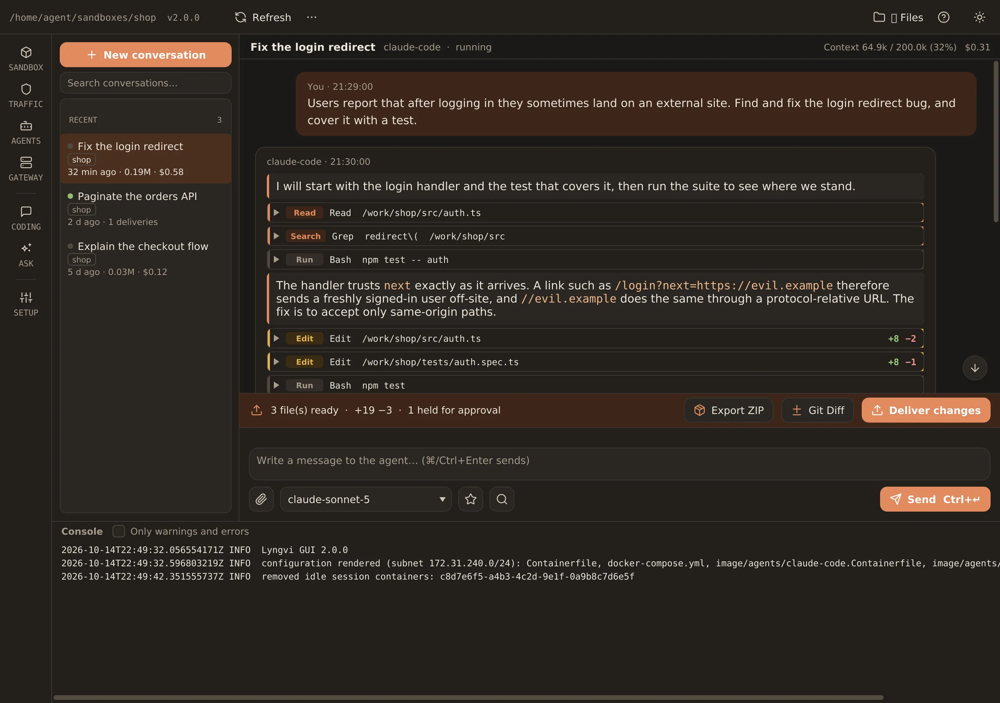
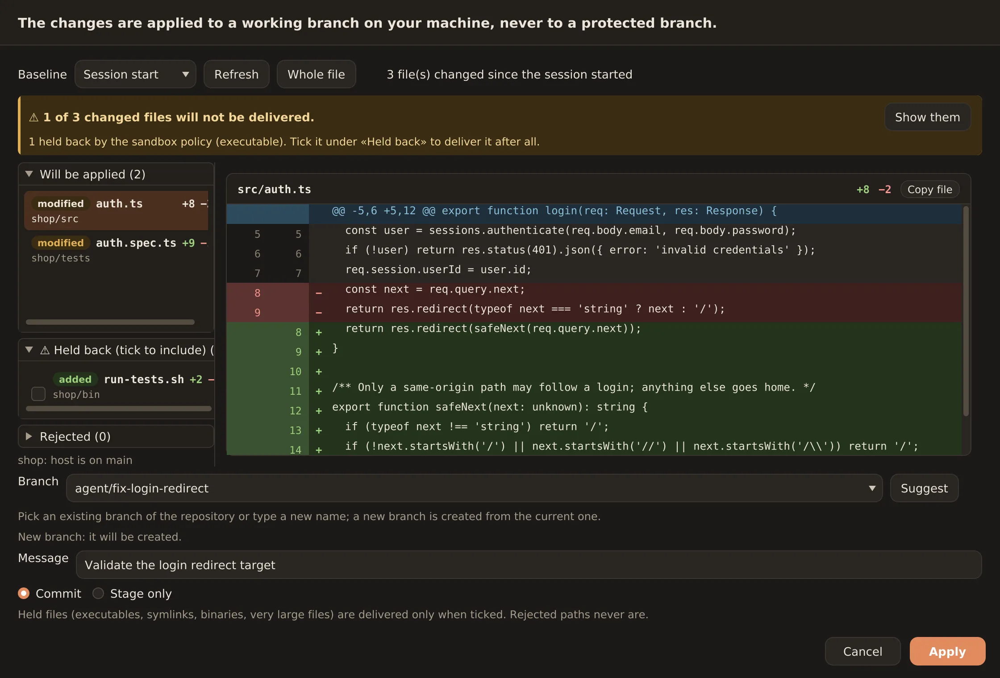
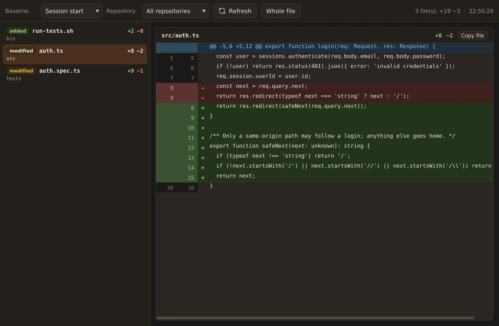
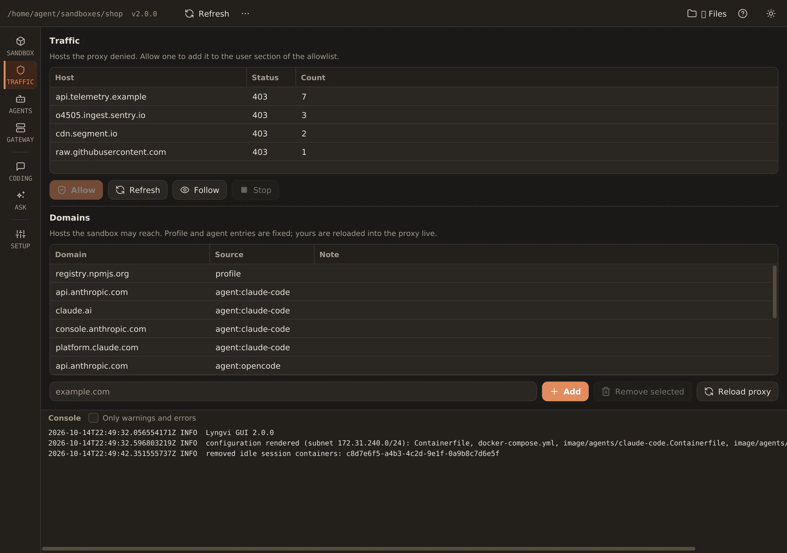
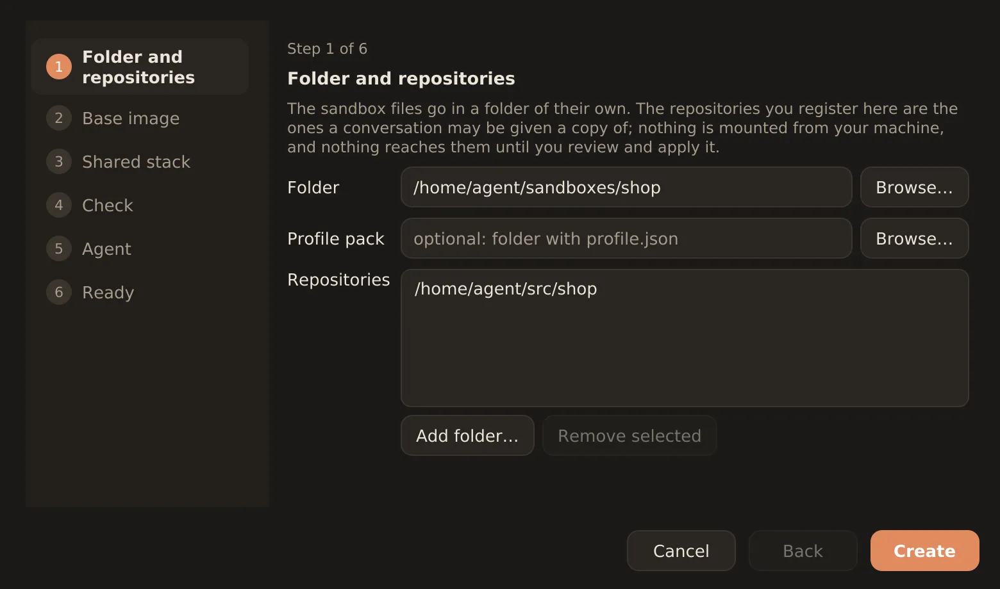

# Lyngvi

[lyngvi.no](https://lyngvi.no) · [Releases](https://github.com/joachimhs/lyngvi/releases/latest) · MIT

Lyngvi is a hardened, agent-agnostic sandbox for running autonomous coding agents
against your own repositories. The agent gets an isolated working copy and
controlled network access. Your original Git configuration and credentials for
internal systems stay outside its reach.

Use the desktop app to keep the conversation, code changes and review in one
window, or work from the command line. Every app feature is also available through
the CLI, which is bundled with the app and available as a separate download. Both
interfaces use the same core.

Lyngvi takes its name from the island in Norse mythology where Fenrir was bound:
a place where great power is kept within clear boundaries. Inside the sandbox,
an agent can explore code, build projects and run tests. Network access is
controlled, the gateway protects credentials for internal systems, and changes
are returned as patches for you to review before applying them. The agent's own
login credentials are available inside its container.

The wolf in the logo represents the agent's power, the surrounding barrier its
boundaries, and the three sparkles its artificial intelligence.

Lyngvi is built on four security principles:

1. **No direct internet access.** All outbound traffic passes through a Squid
   proxy with an allowlist and an explicit blocklist.
2. **No access to your original `.git` directory.** The agent works in a copy or
   a sanitised clone with a fresh `.git` directory. Hooks, configuration and
   remotes from the host are not carried over.
3. **Credentials for internal systems stay in the gateway.** A separate gateway
   container provides read-only access to approved content. The agent never sees
   those credentials.
4. **You approve changes before they are applied.** Lyngvi classifies each file
   on your machine as ready to apply (`apply`), requiring explicit approval
   (`hold`), or rejected (`reject`). Approved changes go to a working branch,
   never directly to `main`.

Status: **pre-release** (`2.0.0`). See `CHANGELOG.md`.

## The desktop app



Each task has its own conversation, where you can follow the agent's work step by
step. See which files it reads, which searches and commands it runs, and what it
changes. Each edit shows the number of lines added and removed, and each turn
reports token usage and cost in dollars.

Responses stream as they arrive, alongside a “Thinking” block, tool calls and
usage. Drag across messages or shift-click to select them, then copy with
⌘/Ctrl+C or the context menu.

Add attachments with the attach button, drag files into the composer, or paste
from the clipboard with ⌘/Ctrl+V. Pasted images are saved as PNG files and sent
with the message. The status strip above the composer shows which changes are
waiting to be applied and which files require explicit approval.

| Deliver changes | Git Diff |
| --- | --- |
|  |  |
| Lyngvi checks the patch on your machine and groups files into those ready to apply, those requiring explicit approval, and rejected paths. The executable in this example is included only if you select it. Choose a working branch and enter a commit message to apply the approved changes. Protected branches are refused. | Select a changed file on the left to view it on the right. Compare against the session start or any previous delivery. “Whole file” displays the complete file with changes highlighted. |

| Traffic | New sandbox |
| --- | --- |
|  |  |
| See every host the proxy has denied and the number of connection attempts. The allowlist shows where each entry comes from: the profile, the agent or your own additions. New permissions take effect without restarting the proxy. | “New sandbox…” guides you through setup: choose a folder and repositories (`init` and `rebuild-config`), build the base image (`build`, with output shown in the dialog), start the shared services (`up`), check the setup (`doctor`) and log in to an agent. Checks and login can be skipped and completed later. |

Both “Git Diff” and “Deliver changes” let you choose a baseline: the session start
or any previous delivery in the conversation. Deliveries are listed by time and
branch, with the latest selected by default. Both views use the same review and
apply workflow as `session review` and `session apply`. Held files must be selected
explicitly; rejected files are never applied.

The sidebar groups Sandbox, Traffic, Agents, Skills and Gateway; Agentic coding
and Ask the agent; and Repositories, Domains, Profile and Toolchain. The app also
has a console and a separate files window (⌘/Ctrl+B) that displays the selected
session's working copy alongside the main window. The files window remembers its
size and position.

Next to “Git Diff” and “Deliver changes”, “Export ZIP” saves the entire session as
one archive when the normal delivery workflow cannot be completed. It remains
available even when a review finds no changes.

The Usage view under Agents shows quotas and spending for the selected agent.
Quotas reported by the account appear as one bar per limit, with warnings at 75%,
alerts at 90%, and reset times. It also shows the sandbox's token usage and costs
by model and conversation, using the same data as `lyngvi agent usage <id>`.
Agents that do not report account usage, including Claude Code, show only the
usage recorded by the sandbox.

Theme, window and last-used sandbox settings are stored in
`~/.lyngvi-gui.properties`.

Install it from a release (below — the CLI ships inside it), or run it from a source
checkout:

```sh
mvn -q install -DskipTests            # once, so the modules are in the local repository
mvn -pl lyngvi-gui javafx:run         # opens the window; picks $LYNGVI_HOME or the last sandbox
```

Pass a sandbox with `LYNGVI_HOME=/path/to/sandbox` or `--sandbox=/path`.

The desktop app provides its own setup wizard, conversation view, Markdown and
syntax highlighting, diff viewer, review workflow and files window. Its codebase
is roughly the same size as the core.

All sandbox logic lives in the core. Views use viewmodels, which call the same
`core.api` operations as the CLI. Long-running calls use virtual threads. The GUI
never starts processes or writes sandbox state directly. A source-level
architecture test enforces this separation, so both interfaces share one
implementation of the security-critical delivery workflow.

See more screenshots and a walkthrough in English and Norwegian on [lyngvi.no](https://lyngvi.no).

## Install

Releases include a desktop app for each platform, built with jpackage and bundled
with the CLI. Download `lyngvi-gui-<version>-<os>-<arch>.tar.gz` for the macOS `.app`
or Linux application image. Installers are also available as a `.dmg` on macOS
and a `.deb` on Linux.

The CLI is available separately as `lyngvi-cli-<version>-<os>-<arch>.tar.gz`.
It is packaged with jlink and includes its own Java runtime, so you do not need
to install Java.

The packages are not yet signed or notarised. On macOS, open the app for the
first time with right-click → Open, or run
`xattr -dr com.apple.quarantine lyngvi.app`.

- **The app:** unpack it (or install the `.dmg` or `.deb`) and use “New sandbox…” to complete the initial setup;
  `init` from the app links the sandbox's `cli/` to the app's runtime, so the CLI works from the sandbox
  folder without a download.
- **CLI only:** create a folder, put `setup.sh` from the release in it, run `./setup.sh --download`, then
  `./setup.sh init --repo <path>`. `setup.sh` finds the runtime in this order: `$LYNGVI_CLI`, `./cli/`, an
  installed app (`/Applications/lyngvi.app`, `/opt/lyngvi`), then `java` 25+ with the CLI jar.
- **From source:** `mvn -q install -DskipTests`, then `./setup.sh --sandbox <dir> init …`; the GUI runs with
  `mvn -pl lyngvi-gui javafx:run`. `mvn -Pdist package -DskipTests` builds the release artifacts into
  `lyngvi-cli/target/dist/` (CLI image, tar.gz, sha256) and `lyngvi-gui/target/dist/` (app image plus dmg on
  macOS or deb on Linux); the same scripts live in `packaging/`; `.github/workflows/release.yml` builds them for four platforms on a `v*` tag.
  On a Mac, `packaging/build-dmg.sh` does the disk image alone: build, jpackage, `lyngvi-gui-<version>-macos-<arch>.dmg` and its `.sha256` in `dist/`.
- **Upgrading:** after installing a newer Lyngvi, run `./setup.sh upgrade` in each sandbox (the GUI offers it);
  `doctor` reports a stale `cli/` or bundled files until you do. `version --check` compares with the latest release
  (`LYNGVI_RELEASE_API` overrides the endpoint).
- **From 1.1.2:** `./setup.sh --sandbox <old sandbox> migrate` migrates the existing sandbox directory, including its configuration, a generated
  profile pack `profiles/migrated/` (allowlist, toolchains, language, enterprise URL), the gateway manifest with
  allowlists and secrets, conversations, sessions and the subnet register. The GUI offers the same when you open a
  1.1.2 folder. After migration, run `build` and log in to an agent. Migrated conversations belong to the `copilot-cli` agent
  and stay readable.

## Requirements

- Java 25 to build from source. Release packages include their own runtime.
- Podman 5 or newer to run sandboxes (not needed for M0).
- macOS or Linux.

## Build

```sh
mvn -q verify
./setup.sh version [--check]      # --check asks the release API for a newer version
./setup.sh upgrade                # refresh bundled files and cli/ after updating Lyngvi
./setup.sh migrate                # convert a 1.1.2 sandbox in place (profile pack profiles/migrated)
./setup.sh doctor [--deep]        # --deep: egress self-test from a throwaway container
./setup.sh --download             # fetch the CLI image for this platform into cli/ (checksum verified)
```

`setup.sh` locates a runtime and starts `lyngvi-cli` for the sandbox directory.
It checks `$LYNGVI_CLI`, `./cli/bin/lyngvi`, an installed desktop app, and then
`java` 25 or newer on `PATH` with the CLI JAR. By default it uses the directory
containing the launcher. Set `$LYNGVI_HOME` or pass `--sandbox <dir>` to select
another sandbox.

## Commands

```sh
./setup.sh init [--profile <pack-dir>] [--repo <path>]... [--agent <id>] [--yes]
./setup.sh rebuild-config         # render Containerfile, compose, proxy config, AGENTS.md, certificate
./setup.sh upgrade                # refresh the bundled files to this version (after updating Lyngvi), then build
./setup.sh build [--no-cache]     # build localhost/lyngvi-base:<version>
./setup.sh up | down              # the shared stack: proxy and gateway
./setup.sh logs <proxy|gateway> [--follow] [--tail N]
./setup.sh status
./setup.sh doctor                 # exit 1 when any check fails
./setup.sh repo list | add <path> [--name <name>] [--history none|shallow|full] | remove <name|path>
./setup.sh domain list | add <domain> [--note <text>] | remove <domain> | reload | blocked [--follow]
./setup.sh resources show | set [--preset <id>] [--mem 8g] [--memswap 12g] [--cpus 4.0] [--pids 2048] | presets | machine
./setup.sh profile show
./setup.sh skill list | show <name> | new <name> | remove <name> | enable <name> | disable <name> | sync   # the sandbox's skills
./setup.sh session new [--title <t>] [--repos a,b | --no-repos] [--agent <id>] [--history none|shallow|full] [--depth N] [--preset <id>] [--mem ...]
./setup.sh session list | show <id> | rename <id> <title> | status <id>
./setup.sh session start <id> | stop <id> | remove <id> [--keep-conversation] | gc [--idle <min>]   # gc also removes containers and volumes without a session
./setup.sh session fetch <id> [--path <dir>] [--to <dir>]   # copy a directory out of the session (default: output/)
./setup.sh session export <id> [--to <file|dir>] [--no-git] [--all]   # the whole session as one zip; the way out when a delivery will not work
./setup.sh clean [--containers] [--work] [--images] [--cache] [--all] [--older-than <days>]   # shows what can be reclaimed; --yes removes it
./setup.sh shell [<id>]         # interactive shell in the session's container
./setup.sh session ask <id> [--prompt-file <f>] [--model <m>] [--attach <file>]...   # prompt from stdin otherwise
./setup.sh session suggest <id>
./setup.sh session diff <id> [--from start|last|n] [--repo <r>] [--path <f>]
./setup.sh session review <id> [--from ...]          # apply / hold / reject per file; exit 7 when nothing changed
./setup.sh session apply <id> --branch <b> [--message <m>] [--mode commit|stage] [--include <f>]... [--from ...]
./setup.sh agent list | status <id> | models <id> | login <id> [--mode <m>] | logout <id> | usage <id>
./setup.sh gateway list | status [--deep] | logs [--follow] | restart | rebuild [--no-cache]
./setup.sh gateway instance add <id> --hostname <host> [--plugin http|confluence|jira|...] [--alias <host>]... [--scheme bearer|basic|header:<n>|query:<n>] [--mode path-prefix|path-exact|path-regex|query:<p>|none] [--config '<json>']
./setup.sh gateway instance show <id> | remove <id>
./setup.sh gateway secret set <id> [--url <base-url>] [--token-stdin] | status <id> | clear <id>
./setup.sh gateway allow <id> list | add <entry> | remove <entry>
./setup.sh gateway plugin list | install <jar> | remove <jar-name>
./setup.sh gateway cert show | renew
./setup.sh version [--check]      # --check asks the release API for a newer version
./setup.sh upgrade                # refresh bundled files and cli/ after updating Lyngvi
./setup.sh migrate                # convert a 1.1.2 sandbox in place (profile pack profiles/migrated)
./setup.sh doctor [--deep]        # --deep: egress self-test from a throwaway container
./setup.sh --download             # fetch the CLI image for this platform into cli/ (checksum verified)
```

### Review and apply changes

Choose a baseline for the comparison: the session start (`start`), the previous
delivery (`last`), or the index of an earlier delivery. Lyngvi checks the files
on your machine and applies approved changes to a working branch, never directly
to `main`.

Held files, such as executables, symlinks and binaries, are included only when
named with `--include`. Rejected paths are never applied.

### Agents and login

The built-in agents, `claude-code` and `opencode`, are configured in
`agents/<id>/agent.json`. Log in with `./setup.sh agent login claude-code`, which
uses the agent's own OAuth flow for subscription access. Alternatively, add a token
to `state/agents/claude-code/env`: `CLAUDE_CODE_OAUTH_TOKEN=...` from
`claude setup-token`, or `ANTHROPIC_API_KEY=...`.

Credentials are stored under `state/agents/<id>/` and mounted only into that
agent's containers.

### Local models

Models running on your machine, including Ollama, LM Studio and an MLX server
such as oMLX behind LM Studio's API, are reached at `host.containers.internal`.
The proxy allows access on the ports listed under `localModels.ports` in
`profile.json`. The default ports are `11434` and `1234`.

OpenCode lists only models declared in its configuration, so you must register
the models your server loads. In the app, open **Agents → “Local models…”** and
enter the server address, model IDs and an API key if required. The key is stored
in `state/agents/<id>/env` with the agent's other credentials. “Test” queries the
server and marks each model ID as available or missing.

Your own model server does not require an agent login. The setup dialog is
therefore also available wherever the app offers login: the “Own models” column
on the Agents page shows each agent's configuration status, and the first-run
wizard offers the same dialog beside “Log in…”.

For manual configuration, copy `agents/opencode/opencode.example.json` to
`state/agents/opencode/config/opencode/opencode.json` and adjust it for your server.
The models then appear in `agent models opencode --refresh` and in the model picker.

### Responses and JSON events

`session ask --json` streams one JSON event per line (`start`, `text`, `tool_start`,
`tool_end`, `usage`, `done`, ...). Without `--json` the reply is printed as it
arrives. Try it without any real agent by enabling `mock` in `profile.json`
(`agents.enabled`) and creating a session with `--agent mock`.

### First run, step by step

Each session gets its own container. The agent works in `/work/<repo>`, with a
separate working copy and a fresh `.git` directory. Files intended for you go in
`/work/output`, attachments are available in `/work/_attachments`, and workspace
instructions are in `/work/AGENTS.md`. The agent's own credentials are mounted
separately. The rest of the host filesystem is not available inside the container.

`init` creates the sandbox's own `setup.sh` and a copy of the CLI
into `<sandbox>/cli/`, so after `init` you run the sandbox's launcher from its folder
(or pass `--sandbox <dir>` / set `LYNGVI_HOME` from anywhere):

```sh
./setup.sh --sandbox ~/sandboxes/my-app init --repo ~/src/my-app
cd ~/sandboxes/my-app
./setup.sh rebuild-config
./setup.sh build
./setup.sh up
./setup.sh doctor
./setup.sh session new --title "Look around"
./setup.sh shell
```

After updating Lyngvi, run `./setup.sh upgrade` in each sandbox: it refreshes the
bundled files and the CLI copy, and `doctor` warns until you do.

### Network access

All outbound traffic from sandbox containers passes through the Squid proxy on the
internal network. The allowlist has three sections (profile, agents, user); the
user section is edited with `domain add|remove`, and changes take effect without a restart. Denied hosts
show up in `domain blocked`.

### Skills

Skills provide instructions the agent can load when needed, keeping specialised
workflows out of `AGENTS.md`. Each skill has its own directory under
`<sandbox>/skills/`, with a `SKILL.md` file. The agent reads the `name` and
`description` front matter before deciding whether to open the full instructions.

Enabled skills are copied into the agent's configuration directory before each
message. Changes therefore take effect with the next message in every
conversation, including those already running. Disabling a skill keeps its files
but removes it from the agent's configuration. Each sandbox has its own skills.

Use `skill list|new|enable|disable|remove|show|sync` on the command line or “Skills”
in the app's sidebar. `init` creates four starter skills: `deliver-change`,
`blocked-host`, `verify-in-sandbox` and `gateway-call`.

### Access to internal systems

A separate gateway container holds the credentials for internal systems. The agent
gets a hostname and a read-only API limited to approved content. The sidecar is a
Java runtime (`gateway/gateway.jar`, jlink image built from `gateway/Containerfile`)
and every system type is a plugin: `http` is built in (any REST API behind a static
secret, declared with `--config`), `confluence` and `jira` ship as jars in
`gateway/plugins/`, and your own jar is a class implementing `GatewayPlugin` from
`lyngvi-gateway-api` plus a `META-INF/services` entry, dropped in with
`gateway plugin install`. To add a system:

```sh
./setup.sh gateway instance add wiki --plugin confluence --hostname wiki.gateway.local
printf '%s\n' "$TOKEN" | ./setup.sh gateway secret set wiki --url https://wiki.example.com --token-stdin
./setup.sh gateway allow wiki add space:OPS      # or a page id, or a browser URL
./setup.sh gateway restart                        # allowlist edits do not need this
./setup.sh gateway status --deep
```

Inside a session the agent then uses `https://wiki.gateway.local/page/<id>` or
`$WIKI_GATEWAY_URL`. An HTTP 403 response means you must approve access to the item first;
`gateway status` shows every instance, its routes and allowlist. Write access
(`POST` and friends) is off unless the instance has the `write` capability *and*
`profile.json` lists it under `gateway.allowWrite`.

### Common options and exit codes

Every command accepts `--json`, `--lang <code>` and `--yes`. With `--json`, ordinary
commands return one JSON document on stdout: `{"ok":true,...}` or
`{"ok":false,"error":{"code","message","data"}}`. As described above,
`session ask --json` returns a stream of events instead.
Exit codes: 0 ok, 1 internal or doctor failure, 2 invalid argument, 3 not
initialised, 4 validation failed, 5 external command failed, 6 interrupted,
7 no changes.

## Sandbox files and storage

A sandbox directory contains `profile.json` (copied from the profile pack),
`sandbox.config` (local state; never edit by hand), `.env`, the bundled
`profiles/`, `templates/`, `agents/`, `image/`, `proxy/`, `scripts/` and `gateway/`
(runtime jar, plugins, manifest, allowlists, secrets, certificate), `state/` and `.sessions/`.

### Cleanup and caches

Each session leaves behind a working copy and a container. Version upgrades can
also leave older container images. `setup.sh clean` shows what can be removed;
add `--yes` to remove it. `doctor` reports when there is a substantial amount to
clean up.

Cleanup affects only objects belonging to this sandbox. Other workloads you run
with Podman are left alone.

Tool caches such as `~/.npm` and `~/.m2` are shared between sessions in the same
sandbox, avoiding repeated downloads. See `cache` in `docs/profiles.md`. Use
`session new --cache off` for a session that needs separate caches.

### Working copies and output files

A session's working copy and the agent's output are **not** stored directly in
the sandbox directory. They live in a Podman volume, `<container>-work`, mounted
as `/work` in the container. This includes the agent's `.git` directory. On macOS,
Podman manages the volume inside its virtual machine; on Linux, Podman manages it
on the host.

`.sessions/<id>/` contains files written by the host: the container's environment
file, attachments you send in, and patches from the most recent review. Use
`setup.sh session fetch <id>` or the app's file pane to copy files out of the
agent's `output/` directory.

### Export a session as ZIP

If a patch cannot be applied, the host repository has diverged too far, or the
changes do not fit the patch workflow, export the entire session with
`setup.sh session export <id>` or “Export ZIP” next to Git Diff in the conversation.

The archive contains every working copy with its Git history, plus the agent's
`output/` directory. Export does not modify the session or apply changes to your
repository, so you can still use the normal delivery workflow later.

Build output and dependencies are excluded unless you pass `--all`. Symbolic
links are never included. Exported `.git` directories omit `hooks/` and `config`,
since the agent may have modified them. The archive also includes `EXPORT.txt`,
which describes its contents and explains how to bring the work into your own clone.

## Podman on macOS

The CLI and GUI talk to the Podman machine through its API socket (`podman machine inspect`
reports it) whenever `CONTAINER_HOST` is not set, so a broken SSH setup does not stop the
sandbox. `doctor` still reports the underlying problem; a common one is a malformed line in
`~/.ssh/known_hosts` (two entries merged), which makes every plain `podman` command fail
with `knownhosts: ... illegal base64 data`. Remove that line and podman over SSH works
again. `podman compose` needs a provider: `docker-compose` or `podman-compose` on PATH.

## More documentation

- [lyngvi.no](https://lyngvi.no): the product page — the premises, the architecture and the app, screen by screen, in English and Norwegian. Its source is `landingpage/`.
- `docs/agents.md`: writing an agent adapter (`agent.json` or `adapter.sh`) and the event contract.
- `docs/gateway-plugins.md`: writing and packaging a gateway plugin against `lyngvi-gateway-api`.
- `docs/profiles.md`: every section of a profile pack.
- `acceptance/`: the acceptance suite and checklist; `CHANGELOG.md` records what each increment verified.

## Layout

```
lyngvi-gateway-api/      the plugin contract (pure JDK): GatewayPlugin, Route, Request, Response, Manifest, ...
lyngvi-gateway/          the gateway runtime (jdk.httpserver + Jackson) and its test harness
lyngvi-gateway-plugins/  reference plugins: confluence.jar, jira.jar
lyngvi-core/             Java 25 core: all logic, no UI
lyngvi-cli/              picocli front-end; --json on every command
lyngvi-gui/              JavaFX front-end: viewmodels over the core, FXML views, tests without a display
gateway/                    Containerfile bundled into every sandbox
packaging/                  jlink and jpackage scripts for release artifacts (build-dmg.sh for the macOS image); icons/ for the app icon
acceptance/                 acceptance suite (run.sh) and checklist
docs/                       adapter, plugin and profile guides; per-increment plans
docs/branding/              the logo: full lockup and the mark on its own
landingpage/                the source of lyngvi.no (SvelteKit, prerendered); static/screens/ holds the screenshots this README shows
setup.sh                    launcher (copied into every sandbox by init)
docs/plans/                 per-increment task plans
```

## Licence

MIT. See `LICENSE`.
