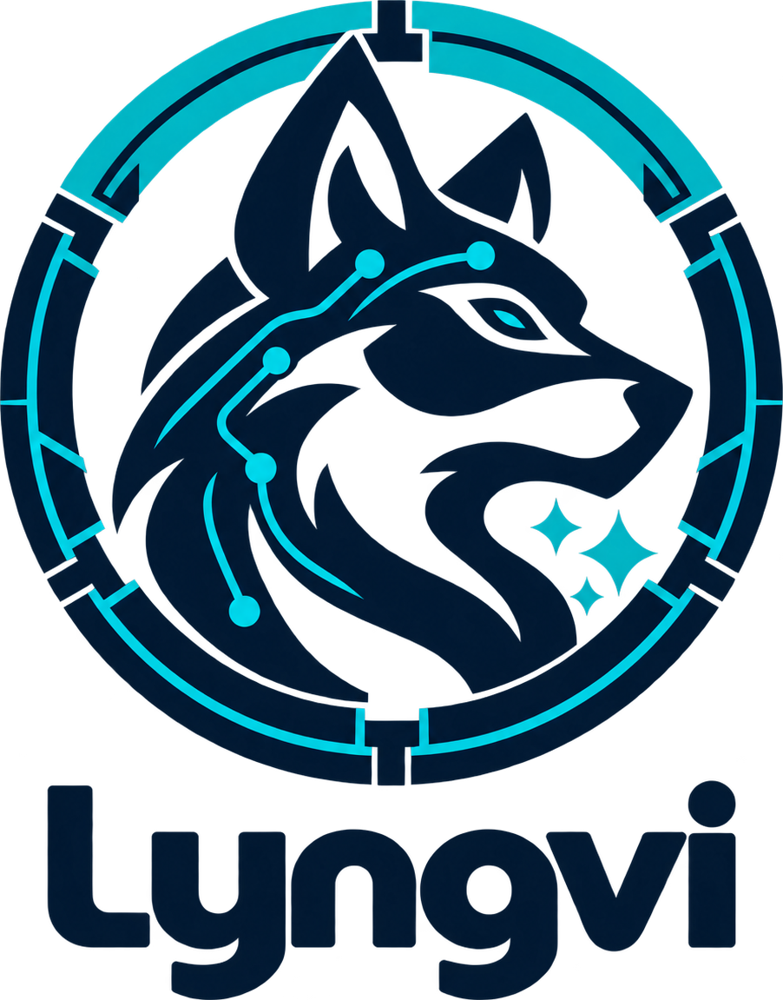

# Lyngvi

A hardened, agent-agnostic sandbox for running autonomous coding agents against
your own repositories without giving the agent your access on the host.

Lyngvi takes its name from the island in Norse mythology where the wolf Fenrir
was bound: a place where great power is kept within defined boundaries. Inside
Lyngvi an agent can explore, build and test in an isolated workspace, while
network access stays controlled, credentials stay outside its reach, and changes
come back as patches for human review. The wolf in the logo is the agent's
power, the surrounding barrier its boundaries, and the three sparkles its
artificial intelligence.

Core premises:

1. **No direct network access.** All egress goes through a Squid proxy with an
   allowlist plus an explicit blocklist.
2. **No access to your `.git`.** The agent works in a copy (or a sanitised clone)
   with a fresh `.git`: no hooks, no config, no remotes from the host.
3. **Secrets live in a gateway sidecar.** Internal systems are reached through a
   read-only, allowlisted API. The agent never sees a token.
4. **Validated, human-approved delivery.** Changes come back as a patch that is
   classified on the host (apply / hold / reject) and land on a working branch,
   never on `main`.

Status: **pre-release** (`2.0.0-M7`). See `CHANGELOG.md`.

## Install

Releases ship a CLI image per platform (`lyngvi-cli-<version>-<os>-<arch>.tar.gz`, jlink, no Java needed)
and the GUI app built with jpackage, with the CLI inside its runtime: `lyngvi-gui-<version>-<os>-<arch>.tar.gz`
(the `.app` or Linux app image), plus a `.dmg` on macOS and a `.deb` on Linux. The artifacts are not signed or
notarised yet: on macOS open the app once with right-click → Open, or run `xattr -dr com.apple.quarantine lyngvi.app`.

- **CLI only:** create a folder, put `setup.sh` from the release in it, run `./setup.sh --download`, then
  `./setup.sh init --repo <path>`. `setup.sh` finds the runtime in this order: `$LYNGVI_CLI`, `./cli/`, an
  installed app (`/Applications/lyngvi.app`, `/opt/lyngvi`), then `java` 25+ with the CLI jar.
- **GUI:** unpack the app; `init` from the GUI links the sandbox's `cli/` to the app's runtime, so the CLI works
  from the sandbox folder without a download.
- **From source:** `mvn -q install -DskipTests`, then `./setup.sh --sandbox <dir> init …`; the GUI runs with
  `mvn -pl lyngvi-gui javafx:run`. `mvn -Pdist package -DskipTests` builds the release artifacts into
  `lyngvi-cli/target/dist/` (CLI image, tar.gz, sha256) and `lyngvi-gui/target/dist/` (app image plus dmg on
  macOS or deb on Linux); the same scripts live in `packaging/`; `.github/workflows/release.yml` builds them for four platforms on a `v*` tag.
  On a Mac, `packaging/build-dmg.sh` does the disk image alone: build, jpackage, `lyngvi-gui-<version>-macos-<arch>.dmg` and its `.sha256` in `dist/`.
- **Upgrading:** after installing a newer Lyngvi, run `./setup.sh upgrade` in each sandbox (the GUI offers it);
  `doctor` reports a stale `cli/` or bundled files until you do. `version --check` compares with the latest release
  (`LYNGVI_RELEASE_API` overrides the endpoint).
- **From 1.1.2:** `./setup.sh --sandbox <old sandbox> migrate` converts the sandbox in place: config, a generated
  profile pack `profiles/migrated/` (allowlist, toolchains, language, enterprise URL), the gateway manifest with
  allowlists and secrets, conversations, sessions and the subnet register. The GUI offers the same when you open a
  1.1.2 folder. Afterwards: `build`, log in to an agent. Migrated conversations belong to the `copilot-cli` agent
  and stay readable.

## Requirements

- Java 25 to build (the released CLI ships its own runtime; see the roadmap).
- Podman 5 or newer to run sandboxes (not needed for M0).
- macOS or Linux.

## Build

```sh
mvn -q verify
./setup.sh version [--check]      # --check asks the release API for a newer version
./setup.sh upgrade                # refresh bundled files and cli/ after updating Lyngvi
./setup.sh migrate                # convert a 1.1.2 sandbox in place (profile pack profiles/migrated)
./setup.sh doctor [--deep]        # --deep: egress self-test from a throwaway container
./setup.sh --download             # fetch the CLI image for this platform into cli/ (checksum verified)
```

`setup.sh` is a launcher with no logic of its own: it finds a runtime
(`$LYNGVI_CLI`, `./cli/bin/lyngvi`, an installed GUI app, or `java` 25+
on `PATH` with the CLI jar) and starts `lyngvi-cli` against the directory
the launcher lives in (`$LYNGVI_HOME`; override with `--sandbox <dir>`).

## Commands

```sh
./setup.sh init [--profile <pack-dir>] [--repo <path>]... [--agent <id>] [--yes]
./setup.sh rebuild-config         # render Containerfile, compose, proxy config, AGENTS.md, certificate
./setup.sh upgrade                # refresh the bundled files to this version (after updating Lyngvi), then build
./setup.sh build [--no-cache]     # build localhost/lyngvi-base:<version>
./setup.sh up | down              # the shared stack: proxy and gateway
./setup.sh logs <proxy|gateway> [--follow] [--tail N]
./setup.sh status
./setup.sh doctor                 # exit 1 when any check fails
./setup.sh repo list | add <path> [--name <name>] [--history none|shallow|full] | remove <name|path>
./setup.sh domain list | add <domain> [--note <text>] | remove <domain> | reload | blocked [--follow]
./setup.sh resources show | set [--preset <id>] [--mem 8g] [--memswap 12g] [--cpus 4.0] [--pids 2048] | presets | machine
./setup.sh profile show
./setup.sh skill list | show <name> | new <name> | remove <name> | enable <name> | disable <name> | sync   # the sandbox's skills
./setup.sh session new [--title <t>] [--repos a,b | --no-repos] [--agent <id>] [--history none|shallow|full] [--depth N] [--preset <id>] [--mem ...]
./setup.sh session list | show <id> | rename <id> <title> | status <id>
./setup.sh session start <id> | stop <id> | remove <id> [--keep-conversation] | gc [--idle <min>]   # gc also removes containers and volumes without a session
./setup.sh session fetch <id> [--path <dir>] [--to <dir>]   # copy a directory out of the session (default: output/)
./setup.sh session export <id> [--to <file|dir>] [--no-git] [--all]   # the whole session as one zip; the way out when a delivery will not work
./setup.sh clean [--containers] [--work] [--images] [--cache] [--all] [--older-than <days>]   # shows what can be reclaimed; --yes removes it
./setup.sh shell [<id>]         # interactive shell in the session's container
./setup.sh session ask <id> [--prompt-file <f>] [--model <m>] [--attach <file>]...   # prompt from stdin otherwise
./setup.sh session suggest <id>
./setup.sh session diff <id> [--from start|last|n] [--repo <r>] [--path <f>]
./setup.sh session review <id> [--from ...]          # apply / hold / reject per file; exit 7 when nothing changed
./setup.sh session apply <id> --branch <b> [--message <m>] [--mode commit|stage] [--include <f>]... [--from ...]
./setup.sh agent list | status <id> | models <id> | login <id> [--mode <m>] | logout <id> | usage <id>
./setup.sh gateway list | status [--deep] | logs [--follow] | restart | rebuild [--no-cache]
./setup.sh gateway instance add <id> --hostname <host> [--plugin http|confluence|jira|...] [--alias <host>]... [--scheme bearer|basic|header:<n>|query:<n>] [--mode path-prefix|path-exact|path-regex|query:<p>|none] [--config '<json>']
./setup.sh gateway instance show <id> | remove <id>
./setup.sh gateway secret set <id> [--url <base-url>] [--token-stdin] | status <id> | clear <id>
./setup.sh gateway allow <id> list | add <entry> | remove <entry>
./setup.sh gateway plugin list | install <jar> | remove <jar-name>
./setup.sh gateway cert show | renew
./setup.sh version [--check]      # --check asks the release API for a newer version
./setup.sh upgrade                # refresh bundled files and cli/ after updating Lyngvi
./setup.sh migrate                # convert a 1.1.2 sandbox in place (profile pack profiles/migrated)
./setup.sh doctor [--deep]        # --deep: egress self-test from a throwaway container
./setup.sh --download             # fetch the CLI image for this platform into cli/ (checksum verified)
```

Delivery is measured from a baseline (`start`, `last` delivery, or a delivery index),
classified on the host, and lands on a working branch: never `main`. Held files
(executables, symlinks, binaries) are delivered only when named with `--include`;
rejected paths never are.

Agents: `claude-code` and `opencode` are built in and configured by
`agents/<id>/agent.json`. Log in once with `./setup.sh agent login claude-code`
(subscription via the agent's own OAuth flow) or put a token in
`state/agents/claude-code/env` (`CLAUDE_CODE_OAUTH_TOKEN=...` from `claude setup-token`,
or `ANTHROPIC_API_KEY=...`). Credentials stay under `state/agents/<id>/` and are
mounted only into that agent's containers.

Models running on your own machine (Ollama, LM Studio, an MLX server such as oMLX
behind LM Studio's API) are reached at `host.containers.internal`: the proxy lets
that host through on the ports in `profile.json` (`localModels.ports`, by default
`11434` and `1234`). opencode only offers models it knows, so the ones your server
loads have to be declared. In the GUI that is **Agents → «Local models…»**: the
address, the model ids, an API key when the server wants one (kept in
`state/agents/<id>/env` with the agent's other credentials), and a «Test» that asks
the server itself and marks each id as available or missing. A server of your own needs no login at all, so it is
offered where a login is: the Agents page's «Own models» column says where each agent stands with one, and the
first-run wizard offers the same dialog beside «Log in…». By hand it is `agents/opencode/opencode.example.json`
copied to `state/agents/opencode/config/opencode/opencode.json`. Either way they
appear in `agent models opencode --refresh` and in the model picker.

`session ask --json` streams one JSON event per line (`start`, `text`, `tool_start`,
`tool_end`, `usage`, `done`, ...). Without `--json` the reply is printed as it
arrives. Try it without any real agent by enabling `mock` in `profile.json`
(`agents.enabled`) and creating a session with `--agent mock`.

A session gets its own container. Inside it the agent sees `/work/<repo>` (a
working copy with a fresh `.git`), `/work/output` (files for you), `/work/_attachments`
and `/work/AGENTS.md`. Nothing else from the host is mounted.

Typical first run. `init` writes the sandbox's own `setup.sh` and a copy of the CLI
into `<sandbox>/cli/`, so after `init` you run the sandbox's launcher from its folder
(or pass `--sandbox <dir>` / set `LYNGVI_HOME` from anywhere):

```sh
./setup.sh --sandbox ~/sandboxes/my-app init --repo ~/src/my-app
cd ~/sandboxes/my-app
./setup.sh rebuild-config
./setup.sh build
./setup.sh up
./setup.sh doctor
./setup.sh session new --title "Look around"
./setup.sh shell
```

After updating Lyngvi, run `./setup.sh upgrade` in each sandbox: it refreshes the
bundled files and the CLI copy, and `doctor` warns until you do.

Egress: everything from a sandbox container goes through the Squid proxy on the
internal network. The allowlist has three sections (profile, agents, user); the
user section is edited with `domain add|remove` and reloaded live. Denied hosts
show up in `domain blocked`.

Skills: instructions the agent reaches for when it needs them, rather than carrying
them in `AGENTS.md` all the time. One folder per skill under `<sandbox>/skills/`, each
with a `SKILL.md` whose front matter (`name`, `description`) is what the agent reads
before deciding to open the rest. The switched-on ones are copied into the agent's own
configuration directory before each message, so a change applies from the next message
in every conversation — running ones included — and switching one off keeps the files
but takes it away from the agent. They belong to the sandbox they are in: another
sandbox folder has its own. `skill list|new|enable|disable|remove|show|sync` on the
command line, «Skills» on the nav rail in the GUI, and four of them are laid down by `init` as a
starting point: `deliver-change`, `blocked-host`, `verify-in-sandbox` and `gateway-call`.

Gateway: internal systems are reached through a sidecar that holds the credentials;
the agent only sees a hostname and a read-only, allowlisted API. The sidecar is a
Java runtime (`gateway/gateway.jar`, jlink image built from `gateway/Containerfile`)
and every system type is a plugin: `http` is built in (any REST API behind a static
secret, declared with `--config`), `confluence` and `jira` ship as jars in
`gateway/plugins/`, and your own jar is a class implementing `GatewayPlugin` from
`lyngvi-gateway-api` plus a `META-INF/services` entry, dropped in with
`gateway plugin install`. Adding a system:

```sh
./setup.sh gateway instance add wiki --plugin confluence --hostname wiki.gateway.local
printf '%s\n' "$TOKEN" | ./setup.sh gateway secret set wiki --url https://wiki.example.com --token-stdin
./setup.sh gateway allow wiki add space:OPS      # or a page id, or a browser URL
./setup.sh gateway restart                        # allowlist edits do not need this
./setup.sh gateway status --deep
```

Inside a session the agent then uses `https://wiki.gateway.local/page/<id>` or
`$WIKI_GATEWAY_URL`. A 403 tells the agent the human must allow the item first;
`gateway status` shows every instance, its routes and allowlist. Write access
(`POST` and friends) is off unless the instance has the `write` capability *and*
`profile.json` lists it under `gateway.allowWrite`.

Every command accepts `--json` (one JSON document on stdout, `{"ok":true,...}` or
`{"ok":false,"error":{"code","message","data"}}`), `--lang <code>` and `--yes`.
Exit codes: 0 ok, 1 internal or doctor failure, 2 invalid argument, 3 not
initialised, 4 validation failed, 5 external command failed, 6 interrupted,
7 no changes.

A sandbox directory contains `profile.json` (copied from the profile pack),
`sandbox.config` (local state; never edit by hand), `.env`, the bundled
`profiles/`, `templates/`, `agents/`, `image/`, `proxy/`, `scripts/` and `gateway/`
(runtime jar, plugins, manifest, allowlists, secrets, certificate), `state/` and `.sessions/`.

Sessions leave things behind: a working copy each, a container each, and a whole set
of images every time the version changes. `setup.sh clean` shows what can be reclaimed
and removes it with `--yes`; `doctor` mentions it when there is a lot. It only ever
touches this sandbox's own objects, never anything else you run under Podman. Tool
caches (`~/.npm`, `~/.m2` and the rest) are shared between the sessions of a sandbox
instead of downloaded once per session — see `cache` in `docs/profiles.md`, and
`session new --cache off` for a session that should keep to itself.

A session's own files — the working copy and the agent's output — are **not** in the
sandbox directory. They live in a Podman volume (`<container>-work`) that is the
container's `/work`, so nothing the agent writes, its `.git` included, is in the host's
filesystem. `.sessions/<id>/` holds only what the host writes: the container's environment
file, the attachments you send in, and the last review's patches. Use
`setup.sh session fetch <id>` (or the GUI's file pane) to copy the agent's `output/` out.

When a delivery cannot be made to work — the patch will not apply, the host repository
has moved too far, the changes are the wrong shape for a patch — `setup.sh session export
<id>` (or «Export ZIP» next to Git Diff in the chat) writes the whole session to one zip
on your machine: every working copy as it is, with its git history, and the agent's
`output/`. It applies nothing and changes nothing in the session, so a delivery can still
be made afterwards. Build output and dependencies are left out unless you pass `--all`,
symbolic links never travel, an exported `.git` comes without its `hooks/` and `config`
(the agent could write to those, and you are about to run git in the extracted copy), and
the archive carries an `EXPORT.txt` that says what it holds and how to get the work into
your own clone.

## GUI (M9)

The JavaFX front-end is a thin shell over the same core the CLI uses: every button
calls a `core.api` operation, long calls run on virtual threads, and the GUI never
runs `git` or `podman` itself (an architecture test enforces it). Run it from the
repository with:

```sh
mvn -q install -DskipTests            # once, so the modules are in the local repository
mvn -pl lyngvi-gui javafx:run      # opens the window; picks $LYNGVI_HOME or the last sandbox
```

Pass a sandbox with `LYNGVI_HOME=/path/to/sandbox` or `--sandbox=/path`.
«New sandbox…» opens a wizard that walks the first run above: the folder and its repositories
(`init` and `rebuild-config`), the base image (`build`, its output in the dialog), the shared stack
(`up`), the checks (`doctor`) and the agent login, ending in a sandbox you can start a conversation
in — the checks and the login can be passed by and done later. The
window has a nav rail (Sandbox, Traffic, Agents, Skills, Gateway; Agentic coding, Ask the
agent; Repositories, Domains, Profile, Toolchain), a console, and a files window
(⌘/Ctrl+B) that shows the selected session's working copy beside the main window,
at the size and in the place you put it. Chat bubbles stream
live text, a "Thinking" block, tool calls and usage; drag across bubbles (or shift-click)
to select messages and copy them with ⌘/Ctrl+C or the context menu. The composer takes
attachments from the attach button, from files dropped on it, and from the clipboard with
⌘/Ctrl+V — a pasted image is saved as a PNG and sent along. "Git Diff" lists the changed
files on the left and shows the selected one on the right, as its hunks or, with
"Whole file" on, as the complete file with the changes coloured in place. Its baseline
picker — and the one in "Deliver changes" — offers the session start and every delivery
made in the conversation, by time and branch, and opens on the newest delivery. Both
use the same review/apply flow as `session review` and `session apply`,
with held files ticked in explicitly and rejected files never applied. Next to them,
"Export ZIP" writes the whole session to one archive on your machine — the last resort
when a delivery will not go through, and the one button in that row that a review
finding nothing cannot disable. The Agents
tab has a Usage view: pick an agent to see the quotas its account reports (a bar
per limit, warned at 75 % and flagged at 90 %, with reset times) and the tokens
and cost this sandbox has spent on it, per model and per conversation. It is the
same data as `lyngvi agent usage <id>`; agents that expose no account usage —
Claude Code among them — show the sandbox roll-up only. Settings
(theme, window, last sandbox) live in `~/.lyngvi-gui.properties`.
Packaging with jpackage is M11; until then the GUI runs from Maven.

## Podman on macOS

The CLI and GUI talk to the Podman machine through its API socket (`podman machine inspect`
reports it) whenever `CONTAINER_HOST` is not set, so a broken SSH setup does not stop the
sandbox. `doctor` still reports the underlying problem; a common one is a malformed line in
`~/.ssh/known_hosts` (two entries merged), which makes every plain `podman` command fail
with `knownhosts: ... illegal base64 data`. Remove that line and podman over SSH works
again. `podman compose` needs a provider: `docker-compose` or `podman-compose` on PATH.

## More documentation

- `docs/agents.md`: writing an agent adapter (`agent.json` or `adapter.sh`) and the event contract.
- `docs/gateway-plugins.md`: writing and packaging a gateway plugin against `lyngvi-gateway-api`.
- `docs/profiles.md`: every section of a profile pack.
- `acceptance/`: the acceptance suite and checklist; `CHANGELOG.md` records what each increment verified.

## Layout

```
lyngvi-gateway-api/      the plugin contract (pure JDK): GatewayPlugin, Route, Request, Response, Manifest, ...
lyngvi-gateway/          the gateway runtime (jdk.httpserver + Jackson) and its test harness
lyngvi-gateway-plugins/  reference plugins: confluence.jar, jira.jar
lyngvi-core/             Java 25 core: all logic, no UI
lyngvi-cli/              picocli front-end; --json on every command
lyngvi-gui/              JavaFX front-end: viewmodels over the core, FXML views, tests without a display
gateway/                    Containerfile bundled into every sandbox
packaging/                  jlink and jpackage scripts for release artifacts (build-dmg.sh for the macOS image); icons/ for the app icon
acceptance/                 acceptance suite (run.sh) and checklist
docs/                       adapter, plugin and profile guides; per-increment plans
docs/branding/              the logo: full lockup and the mark on its own
setup.sh                    launcher (copied into every sandbox by init)
docs/plans/                 per-increment task plans
```

## Licence

MIT. See `LICENSE`.
